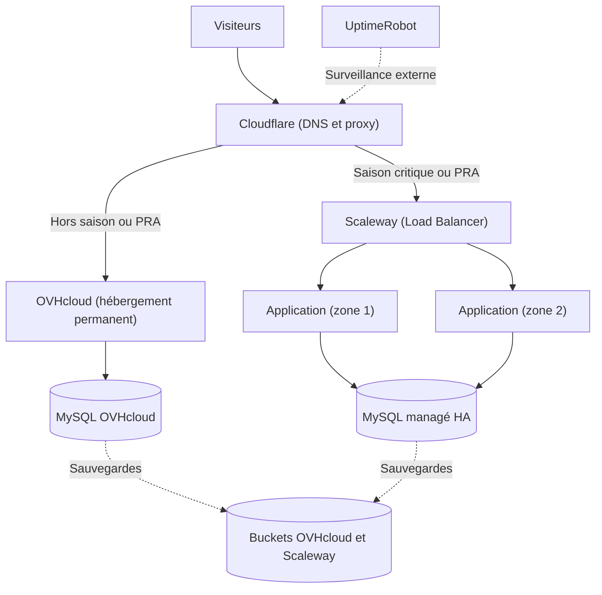

# Haute disponibilité saisonnière et PRA

Infrastructure de **haute disponibilité saisonnière** et de **reprise d'activité (PRA)** entre OVHcloud et Scaleway.

OVHcloud assure l'hébergement permanent. Pendant la période critique, une infrastructure redondante est activée chez Scaleway. Les sauvegardes restent indépendantes de cette infrastructure saisonnière.

## Architecture cible



La redondance Scaleway couvre certaines pannes isolées. Les bascules entre hébergeurs sont manuelles, et un seul environnement accepte les écritures à la fois. En cas de panne majeure de Cloudflare, la gestion DNS est reprise manuellement chez OVHcloud.

## Composants

| Rôle                            | Solution                                                                                                      |
| ------------------------------- | ------------------------------------------------------------------------------------------------------------- |
| Hébergement permanent           | OVHcloud mutualisé et MySQL                                                                                   |
| Haute disponibilité saisonnière | Deux instances Scaleway exécutant Docker dans des zones distinctes, Load Balancer Scaleway et MySQL managé HA |
| Routage                         | DNS et proxy Cloudflare, changement d'origine par API                                                         |
| Provisionnement                 | Terraform, limité aux ressources saisonnières                                                                 |
| Orchestration                   | Scripts versionnés, lancés manuellement                                                                       |
| Sauvegardes                     | Deux buckets permanents chez OVHcloud et Scaleway                                                             |
| Supervision                     | UptimeRobot, Scaleway Cockpit et contrôles de santé du Load Balancer                                          |

## Documentation

- [Architecture](docs/architecture.md)
- [Orchestration](docs/orchestration.md)
- [Sauvegardes](docs/sauvegardes.md)
- [Plan de reprise d'activité](docs/pra/README.md)
- [Simulation locale](docs/simulation.md)

## Simulation locale

PHP 8.4 et MySQL 8.4 représentent l'hébergement OVHcloud. Terraform ajoute les deux instances PHP, HAProxy 3.2 et la base distincte de Scaleway. Le compteur sert à vérifier les écritures et les données après restauration ou bascule.

```sh
docker compose up --build --wait
docker compose run --rm --no-deps app php tests/smoke.php
```

Le test vérifie la page, la santé et une écriture en base. Il ajoute une unité au compteur.

L'application est accessible sur [localhost:8080](http://localhost:8080). La route [/health](http://localhost:8080/health) renvoie `200` si le compteur est lisible en base, `503` sinon. Les identifiants de Compose et de Terraform servent uniquement à la simulation locale.

```sh
docker compose down
```

Voir les [sauvegardes locales](docs/sauvegardes.md#exécution-locale) et les [scénarios Scaleway](docs/simulation.md).
