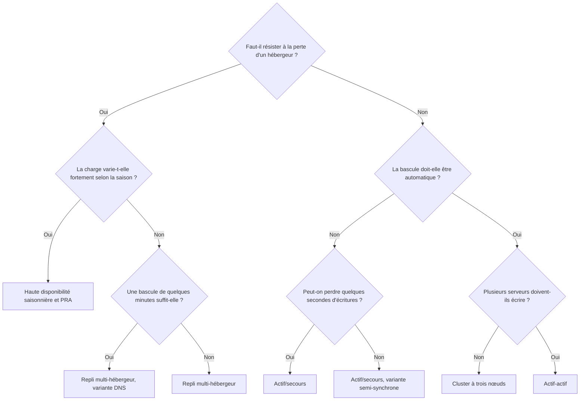

# Exemples HA et PRA

Exemples d'architectures de haute disponibilité et de reprise d'activité, testables en local avec Docker.

| Exemple                                                                                         | Architecture                                                               |
| ----------------------------------------------------------------------------------------------- | -------------------------------------------------------------------------- |
| [Haute disponibilité saisonnière et PRA](examples/seasonal-ha-pra/README.md)                    | OVHcloud permanent, renfort saisonnier chez Scaleway et PRA entre les deux |
| [Actif/secours (InnoDB ReplicaSet)](examples/active-standby/README.md)                          | Deux VPS, réplication asynchrone et IP flottante                           |
| [Cluster à trois nœuds (InnoDB Cluster)](examples/three-node-cluster/README.md)                 | Load balancer, MySQL Router et bascule automatique du primaire             |
| [Actif-actif (Percona XtraDB Cluster)](examples/active-active/README.md)                        | Deux VPS qui écrivent tous les deux, avec un arbitre                       |
| [Repli multi-hébergeur (Cloudflare Load Balancing)](examples/multi-provider-failover/README.md) | Application chez Scaleway et OVHcloud, base managée chez Scaleway          |

Un seul exemple tourne à la fois, car ils utilisent les mêmes ports locaux.

Tous les exemples utilisent la même application PHP, dans [app/](app/). Elle incrémente un compteur stocké dans MySQL et expose une route `/health`. Chaque exemple construit son image à partir de ce dossier et dispose de sa propre documentation.

## Choisir une architecture

Chaque exemple répond à un besoin différent. Les valeurs ci-dessous sont des ordres de grandeur pour comparer les architectures entre elles, pas des engagements de service.

### Comparatif

| Exemple                                           | Perte de données (RPO)                                                          | Reprise (RTO)                                              | Bascule                                               | Coût                                | Complexité |
| ------------------------------------------------- | ------------------------------------------------------------------------------- | ---------------------------------------------------------- | ----------------------------------------------------- | ----------------------------------- | ---------- |
| Haute disponibilité saisonnière et PRA            | Aucune en migration, écritures depuis la dernière sauvegarde en PRA             | Quelques minutes à une heure                               | Manuelle                                              | Faible hors saison, moyen en saison | Élevée     |
| Actif/secours (InnoDB ReplicaSet)                 | Quelques secondes                                                               | Quelques minutes                                           | Manuelle                                              | Faible                              | Faible     |
| Actif/secours, variante semi-synchrone            | Aucune, sauf repli en asynchrone                                                | Quelques minutes                                           | Manuelle                                              | Faible                              | Faible     |
| Cluster à trois nœuds (InnoDB Cluster)            | Aucune                                                                          | Quelques secondes                                          | Automatique                                           | Moyen                               | Moyenne    |
| Actif-actif (Percona XtraDB Cluster)              | Aucune                                                                          | Quelques secondes                                          | Automatique                                           | Faible                              | Moyenne    |
| Repli multi-hébergeur (Cloudflare Load Balancing) | Aucune pour l'application, écritures depuis la dernière sauvegarde pour la base | Quelques secondes pour l'application, minutes pour la base | Automatique pour l'application, manuelle pour la base | Moyen                               | Moyenne    |
| Repli multi-hébergeur, variante DNS               | Aucune pour l'application, écritures depuis la dernière sauvegarde pour la base | Quelques minutes                                           | Manuelle ou par script                                | Faible                              | Faible     |

### Pannes couvertes

| Exemple                                           | Serveur | Hébergeur               | Erreur humaine        |
| ------------------------------------------------- | ------- | ----------------------- | --------------------- |
| Haute disponibilité saisonnière et PRA            | Oui     | Oui, par le PRA         | Jusqu'à la sauvegarde |
| Actif/secours (InnoDB ReplicaSet)                 | Oui     | Non                     | Non                   |
| Actif/secours, variante semi-synchrone            | Oui     | Non                     | Non                   |
| Cluster à trois nœuds (InnoDB Cluster)            | Oui     | Non                     | Non                   |
| Actif-actif (Percona XtraDB Cluster)              | Oui     | Non                     | Non                   |
| Repli multi-hébergeur (Cloudflare Load Balancing) | Oui     | Oui, pour l'application | Jusqu'à la sauvegarde |
| Repli multi-hébergeur, variante DNS               | Oui     | Oui, pour l'application | Jusqu'à la sauvegarde |

La réplication copie aussi les erreurs, comme une table supprimée par mégarde. Seules les sauvegardes permettent de revenir en arrière, et elles restent indispensables dans toutes les architectures.

### Arbre de décision

