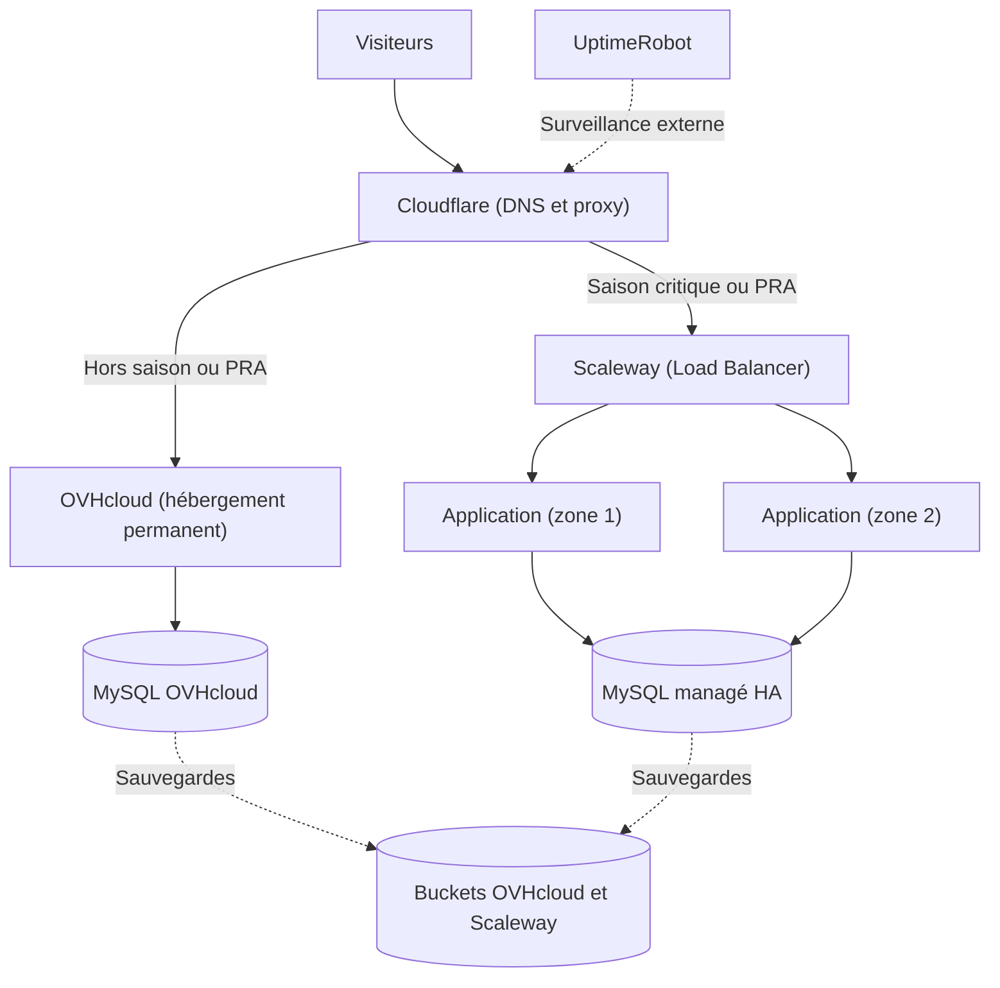

# Seasonal HA & PRA

Infrastructure de **haute disponibilité saisonnière** et de **reprise d'activité (PRA)** entre OVHcloud et Scaleway.

OVHcloud assure l'hébergement permanent. Pendant la période critique, une infrastructure redondante est activée chez Scaleway. Les sauvegardes restent indépendantes de cette infrastructure saisonnière.

## Architecture

La redondance Scaleway couvre certaines pannes isolées. Les bascules entre hébergeurs sont manuelles, et un seul environnement accepte les écritures à la fois. En cas de panne majeure de Cloudflare, la gestion DNS est reprise manuellement chez OVHcloud.

## Composants

| Rôle                            | Solution                                                                                                      |
| ------------------------------- | ------------------------------------------------------------------------------------------------------------- |
| Hébergement permanent           | OVHcloud mutualisé et MySQL                                                                                   |
| Haute disponibilité saisonnière | Deux instances Scaleway exécutant Docker dans des zones distinctes, Load Balancer Scaleway et MySQL managé HA |
| Routage                         | DNS et proxy Cloudflare, changement d'origine par API                                                         |
| Provisionnement                 | Terraform, limité aux ressources saisonnières                                                                 |
| Orchestration                   | Scripts autonomes et Rundeck local sous Docker Compose                                                        |
| Sauvegardes                     | Deux buckets permanents chez OVHcloud et Scaleway                                                             |
| Supervision                     | UptimeRobot, Scaleway Cockpit et contrôles de santé du Load Balancer                                          |

## Documentation

- [Architecture](docs/architecture.md)
- [Orchestration](docs/orchestration.md)
- [Sauvegardes](docs/sauvegardes.md)
- [Plan de reprise d'activité](docs/pra/README.md)
