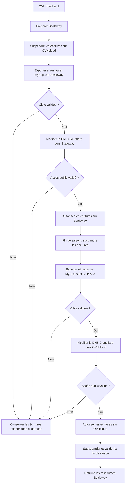

# Architecture

## Environnements

- **OVHcloud** : hébergement mutualisé et MySQL permanents. Pendant la saison, l'application y reste déployée en secours, sans accepter d'écritures.
- **Scaleway** : infrastructure saisonnière avec deux instances Docker réparties entre deux zones de disponibilité, un Load Balancer, un réseau privé et MySQL managé HA.
- **Cloudflare** : DNS et proxy du domaine enregistré chez OVHcloud. Le changement d'origine est piloté par API, sans Load Balancing Cloudflare payant.
- **Sauvegardes** : deux buckets, chez OVHcloud et Scaleway, conservés indépendamment des ressources saisonnières.

Le Load Balancer est déployé dans une zone avec un mécanisme de remplacement. Les deux nœuds MySQL HA sont hébergés dans un même datacenter, sur des racks distincts. Cette architecture couvre des défaillances isolées, **pas la perte complète d'une zone ou d'une région**. Voir la [documentation Scaleway sur MySQL HA](https://www.scaleway.com/en/docs/managed-databases-for-postgresql-and-mysql/faq/) et le [Load Balancer](https://www.scaleway.com/en/docs/load-balancer/faq/).

Un enregistrement DNS `A` proxifié pointe vers l'origine active, OVHcloud hors saison ou le Load Balancer Scaleway pendant la saison. Une bascule le modifie par l'[API DNS Cloudflare](https://developers.cloudflare.com/api/resources/dns/subresources/records/methods/edit/), après vérification de la destination. **Aucune bascule automatique entre fournisseurs n'est prévue.**

Si Cloudflare devient indisponible, le PRA utilise une zone DNS de secours chez OVHcloud et un changement manuel des serveurs DNS du domaine. Voir [PRA Cloudflare](pra/cloudflare.md).

## Supervision

| Contrôle               | Rôle                                                                                     |
| ---------------------- | ---------------------------------------------------------------------------------------- |
| UptimeRobot            | Surveille `/health` sur le domaine public, quel que soit l'hébergeur actif               |
| Load Balancer Scaleway | Écarte les instances qui échouent aux contrôles de santé                                 |
| Scaleway Cockpit       | Collecte les métriques et déclenche les alertes configurées pour les ressources Scaleway |

La route `/health` renvoie `200` si l'application et sa base MySQL répondent, `503` sinon. Elle ne doit pas être mise en cache.

## Cycle saisonnier

Les traitements qui écrivent en base sont suspendus pendant chaque migration. La compatibilité applicative et MySQL est vérifiée avant le changement d'origine. En cas d'échec, les écritures restent arrêtées jusqu'à correction ou retour contrôlé vers la source.

Terraform gère les ressources saisonnières uniquement. Les buckets, les secrets et l'état Terraform ne doivent pas disparaître lors d'un `terraform destroy`.

Les origines doivent disposer d'un accès d'administration sécurisé et de certificats HTTPS publics valides, y compris pour un accès direct sans Cloudflare.
