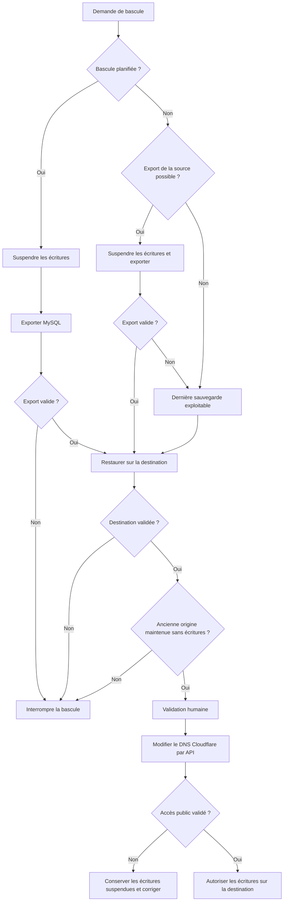

# Orchestration cible

Les opérations reposent sur des scripts versionnés, lancés manuellement en ligne de commande.

La simulation locale utilise Docker Compose et Terraform avec le fournisseur Docker. Les scénarios applicatifs et les migrations peuvent être testés localement. Le comportement des services managés doit être validé chez les fournisseurs.

## Opérations

| Action               | Résultat                                                          |
| -------------------- | ----------------------------------------------------------------- |
| Préparer Scaleway    | `terraform apply`, déploiement et vérifications                   |
| Activer Scaleway     | Migration depuis OVHcloud, puis modification du DNS Cloudflare    |
| Revenir sur OVHcloud | Migration inverse, puis modification du DNS Cloudflare            |
| PRA entre hébergeurs | Reprise depuis la source accessible ou une sauvegarde exploitable |
| Supprimer Scaleway   | `terraform destroy` après validation du retour sur OVHcloud       |

## Bascule

- **Bascule planifiée** : si l'export ou les vérifications échouent, ne pas basculer et rétablir la source si elle est saine.
- **PRA** : si la source est inaccessible, restaurer la dernière sauvegarde exploitable. Une perte de données récentes reste possible.
- **Sécurité des données** : une seule opération de bascule à la fois et une seule base autorisée à écrire. Un mécanisme prévu avant la panne doit garantir que l'ancienne origine n'écrit plus, même après redémarrage. Après la bascule, tout retour exige un nouveau transfert ou une réconciliation.

Le script modifie l'enregistrement `A` proxifié via l'API DNS Cloudflare, avec un jeton limité aux droits nécessaires (`DNS Write`). Il vérifie la réponse de l'API et l'accès public, puis consigne le résultat.

La base MySQL incluse dans un hébergement mutualisé OVHcloud n'accepte pas les connexions directes depuis un serveur externe. Ses exports et restaurations doivent donc passer par un mécanisme autorisé côté hébergement. Voir les [spécificités techniques OVHcloud](https://docs.ovhcloud.com/fr/guides/web-cloud/web-hosting/hosting-technical-specificities).
