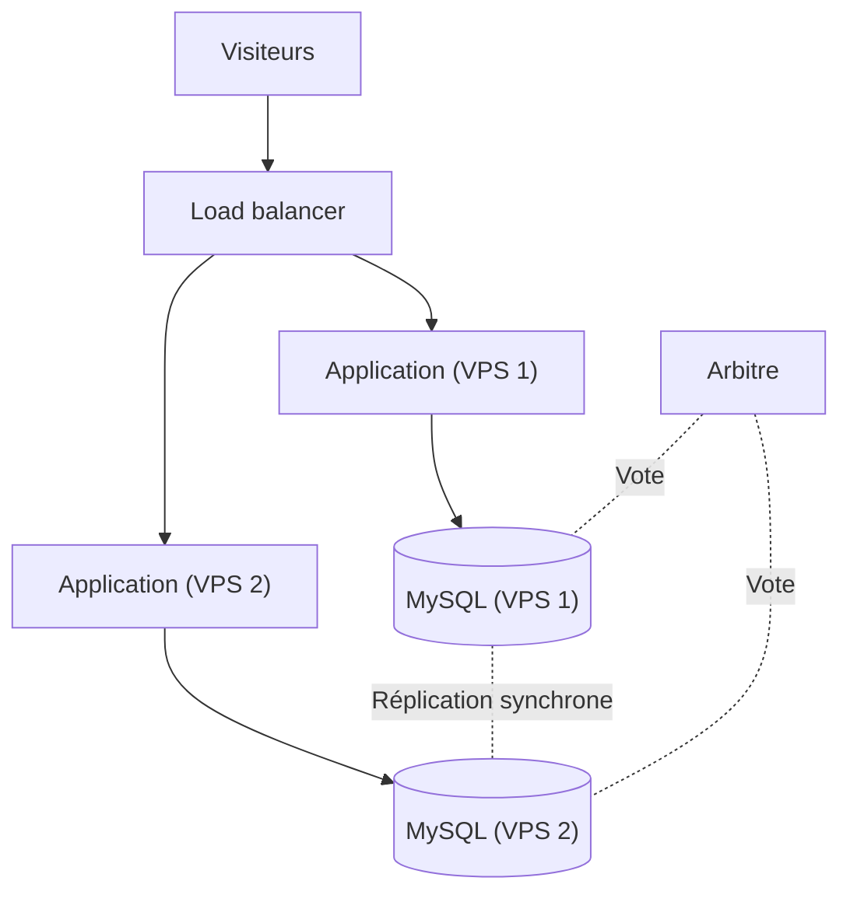

# Actif-actif (Percona XtraDB Cluster)

Deux VPS reçoivent le trafic en même temps, derrière un load balancer. Chacun héberge l'application et un nœud [Percona XtraDB Cluster](https://docs.percona.com/percona-xtradb-cluster/8.4/), une solution de haute disponibilité pour MySQL fondée sur la réplication synchrone avec Galera. Un arbitre, sur une petite machine à part, complète la majorité sans stocker de données.



- Si deux écritures simultanées modifient la même ligne, l'une est refusée avec une erreur, sans perte silencieuse.
- Le load balancer garde chaque visiteur sur le même VPS, pour qu'il relise ses propres écritures.
- Le cluster tolère la panne d'un VPS, car l'autre garde la majorité avec l'arbitre. Sans arbitre, le nœud restant bloquerait les écritures.

## Simulation locale

| Service               | Rôle                     | Accès                                   |
| --------------------- | ------------------------ | --------------------------------------- |
| `lb`                  | Load balancer            | [localhost:8080](http://localhost:8080) |
| `vps1-app`, `vps1-db` | VPS 1                    | [localhost:8081](http://localhost:8081) |
| `vps2-app`, `vps2-db` | VPS 2                    | [localhost:8082](http://localhost:8082) |
| `arbiter`             | Arbitre Galera (`garbd`) |                                         |

Les commandes s'exécutent depuis le dossier de l'exemple, et les identifiants ne servent qu'à la simulation locale. Le chiffrement entre nœuds est désactivé, car il exige des certificats communs aux nœuds.

```sh
./scripts/setup.sh
docker compose up --build --wait
docker compose run --rm --no-deps vps1-app php tests/smoke.php http://lb
```

Le script crée le cluster sur vps1, y fait entrer vps2 par copie complète, puis l'arbitre. Il relance ensuite vps1, qui rejoindra désormais le cluster au lieu d'en créer un nouveau.

## Écritures simultanées

Envoyer des écritures en parallèle sur les deux VPS.

```sh
for i in $(seq 1 30); do
    curl -s -o /dev/null -w '%{http_code}\n' -X POST localhost:8081/ &
    curl -s -o /dev/null -w '%{http_code}\n' -X POST localhost:8082/ &
done | sort | uniq -c
curl localhost:8081/health
```

Une partie des écritures est refusée (`503`), et le compteur augmente exactement du nombre d'écritures acceptées (`303`).

## Panne d'un VPS

Arrêter tous les services de vps1. vps2 garde la majorité avec l'arbitre et continue d'écrire.

```sh
docker compose stop vps1-app vps1-db
sleep 10
docker compose run --rm --no-deps vps2-app php tests/smoke.php http://lb
docker compose start --wait vps1-db vps1-app
```

Au retour du VPS, sa base récupère les écritures faites sur vps2.

## Rôle de l'arbitre

Arrêter l'arbitre, puis simuler la panne brutale de vps2. vps1 se retrouve seul, sans majorité, et refuse les écritures.

```sh
docker compose stop arbiter
docker compose kill vps2-db
sleep 10
curl -s -o /dev/null -w '%{http_code}\n' -X POST localhost:8081/
docker compose start arbiter
docker compose start --wait vps2-db
```

Dès le retour de l'arbitre et de vps2, le cluster se reforme seul et accepte de nouveau les écritures.

## Arrêt

```sh
docker compose down
```

Les volumes MySQL sont conservés. Après un arrêt complet, seul le dernier nœud arrêté peut relancer le cluster, car il détient les dernières écritures. Compose arrête l'arbitre, puis vps2, puis vps1, donc la relance se fait depuis vps1.

```sh
./scripts/setup.sh
docker compose up --build --wait
```

Si vps1 était déjà arrêté avant, par exemple après sa panne, MySQL refuse de relancer le cluster depuis lui. Il faut alors le relancer depuis vps2 avec `./scripts/setup.sh vps2`. Pour repartir de zéro, utiliser `docker compose down -v`.
