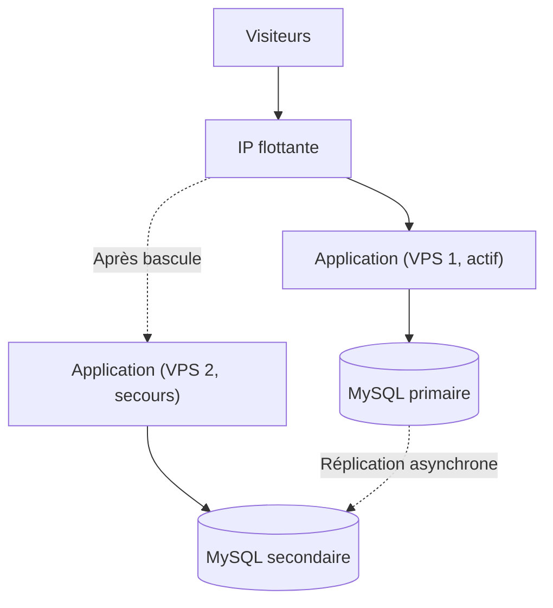

# Actif/secours (InnoDB ReplicaSet)

Deux VPS fonctionnent en actif/secours. Chacun héberge l'application et MySQL sous Docker. [InnoDB ReplicaSet](https://dev.mysql.com/doc/mysql-shell/8.4/en/mysql-innodb-replicaset.html) réplique de façon asynchrone la base du primaire vers le secondaire, et une IP flottante dirige le trafic vers le VPS actif.



- Le secondaire est en lecture seule. L'application du VPS de secours peut donc lire, mais pas écrire.
- La bascule se fait manuellement, en promouvant le secondaire puis en déplaçant l'IP flottante.
- Si le primaire tombe, les dernières transactions non répliquées peuvent être perdues.

## Variante semi-synchrone

Le primaire attend que le secondaire ait reçu chaque écriture avant de la confirmer, grâce à la [réplication semi-synchrone](https://dev.mysql.com/doc/refman/8.4/en/replication-semisync.html). InnoDB ReplicaSet ne la configure pas lui-même, elle s'active avec un plugin MySQL sur chaque base.

- Une panne du primaire ne fait plus perdre d'écriture confirmée.
- Chaque écriture attend la réponse du secondaire, donc elle est un peu plus lente.
- Si le secondaire ne répond plus, le primaire repasse en asynchrone après un délai, pour ne pas bloquer les écritures. La protection disparaît alors jusqu'au retour du secondaire.

Cette variante n'est pas simulée.

## Simulation locale

| Service               | Rôle                                       | Accès                                   |
| --------------------- | ------------------------------------------ | --------------------------------------- |
| `gateway`             | Réseau de l'hébergeur, vers l'IP flottante | [localhost:8080](http://localhost:8080) |
| `vps1-app`, `vps1-db` | VPS 1                                      | [localhost:8081](http://localhost:8081) |
| `vps2-app`, `vps2-db` | VPS 2                                      | [localhost:8082](http://localhost:8082) |

L'alias réseau `vip` simule l'IP flottante, qu'un hébergeur déplace par son API ou par keepalived. Les commandes s'exécutent depuis le dossier de l'exemple, et les identifiants ne servent qu'à la simulation locale.

```sh
docker compose up --build --wait
./scripts/setup.sh
docker compose run --rm --no-deps vps1-app php tests/smoke.php http://gateway
```

Le script crée le ReplicaSet avec vps1 comme primaire, puis copie sa base vers vps2 par clonage.

## Bascule planifiée

```sh
./scripts/switch.sh vps2
```

Le script promeut la base de vps2 puis déplace l'IP flottante. L'ancien primaire devient alors secondaire et réplique depuis vps2. Pour revenir en arrière, lancer `./scripts/switch.sh vps1`.

## Panne du primaire

Avec vps1 actif, simuler sa panne, puis forcer la promotion de vps2.

```sh
docker compose stop vps1-app vps1-db
./scripts/switch.sh vps2 --force
docker compose run --rm --no-deps vps2-app php tests/smoke.php http://gateway
```

Au redémarrage, l'ancien primaire accepte de nouveau les écritures, même s'il ne reçoit plus le trafic. Il faut donc le réintégrer avant toute nouvelle bascule. Cette opération remplace ses données par celles du nouveau primaire, ce qui efface les écritures éventuellement faites entre-temps.

```sh
docker compose start --wait vps1-db vps1-app
docker compose exec vps2-db mysqlsh --no-defaults --uri root:local-root-password@localhost \
    --js -e 'dba.getReplicaSet().rejoinInstance("vps1-db:3306", { recoveryMethod: "clone" })'
```

## Arrêt

```sh
docker compose down
```

Les volumes MySQL et le ReplicaSet sont conservés, mais l'IP flottante revient sur vps1 dès que les conteneurs sont recréés, comme après `docker compose down`. Si vps2 était primaire, il faut donc relancer `./scripts/switch.sh vps2`. Après `docker compose down -v`, tout repart de zéro et `./scripts/setup.sh` doit être relancé.
