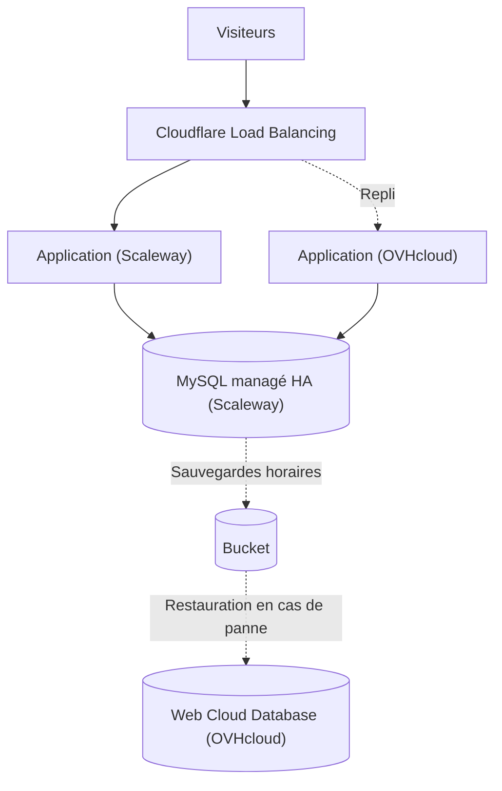

# Repli multi-hébergeur (Cloudflare Load Balancing)

L'application tourne chez Scaleway et chez OVHcloud, derrière le [load balancer de Cloudflare](https://developers.cloudflare.com/load-balancing/). Les deux instances utilisent la même base MySQL managée HA chez Scaleway, et une Web Cloud Database OVHcloud sert de base de repli.



- Cloudflare envoie le trafic vers Scaleway, au plus près de la base. Si l'application Scaleway échoue à son contrôle de santé, il bascule automatiquement vers OVHcloud, puis revient sur Scaleway dès son rétablissement.
- Les deux applications écrivent dans la même base, donc une bascule applicative ne perd aucune donnée.
- La base managée dispose de plusieurs nœuds, et sa panne complète reste peu probable. Dans ce cas, un script bascule sur la Web Cloud Database, à partir d'un export ou de la dernière sauvegarde horaire. La perte de données (RPO) correspond alors à l'intervalle des sauvegardes, une heure ici.

Chez les fournisseurs, l'application OVHcloud se connecte à la base Scaleway par son point d'accès public, en TLS et filtré par adresse IP.

## Variante sans Cloudflare

Le domaine et sa zone DNS restent chez OVHcloud, et un enregistrement DNS remplace le load balancer de Cloudflare. Il pointe vers le VPS Scaleway, et une bascule le fait pointer vers le VPS OVHcloud. Le reste de l'architecture ne change pas.

- C'est moins cher, avec un fournisseur de moins à gérer.
- La bascule n'est pas immédiate. Les visiteurs gardent l'ancienne adresse en cache pendant la durée de vie de l'enregistrement (TTL), même réglée au plus court.
- Le DNS ne surveille pas les serveurs. La bascule est manuelle, ou déclenchée par une supervision externe qui appelle l'API OVHcloud.
- Les VPS sont exposés directement, sans la protection du proxy Cloudflare.

Cette variante n'est pas simulée, car le cache DNS des visiteurs ne se reproduit pas en local.

## Simulation locale

| Service                       | Rôle                                        | Accès                                   |
| ----------------------------- | ------------------------------------------- | --------------------------------------- |
| `cloudflare`                  | Cloudflare Load Balancing                   | [localhost:8080](http://localhost:8080) |
| `scaleway-app`, `scaleway-db` | Scaleway, application et MySQL managé       | [localhost:8081](http://localhost:8081) |
| `ovh-app`, `ovh-db`           | OVHcloud, application et Web Cloud Database | [localhost:8082](http://localhost:8082) |

Les commandes s'exécutent depuis le dossier de l'exemple, et les identifiants ne servent qu'à la simulation locale. Le dossier `backups/` tient lieu de bucket. La haute disponibilité de la base managée et la latence entre hébergeurs ne sont pas simulées.

```sh
docker compose up --build --wait
docker compose run --rm --no-deps scaleway-app php tests/smoke.php
```

## Panne de l'application Scaleway

Arrêter l'application Scaleway. Cloudflare bascule vers OVHcloud, qui continue d'écrire dans la base Scaleway.

```sh
docker compose stop scaleway-app
sleep 10
docker compose run --rm --no-deps ovh-app php tests/smoke.php
docker compose start --wait scaleway-app
```

Au retour de l'application Scaleway, le trafic y revient automatiquement.

## Sauvegardes

Chez les fournisseurs, une tâche planifiée exporte la base active toutes les heures vers un bucket.

```sh
mkdir -p backups
./scripts/backup.sh > backups/scaleway.sql.tmp && mv backups/scaleway.sql.tmp backups/scaleway.sql
```

L'export passe par un fichier temporaire, pour ne pas écraser la sauvegarde précédente s'il échoue.

Sans argument, le script sauvegarde la base Scaleway. Ajouter `ovh` pour sauvegarder la base OVHcloud.

## Panne de la base Scaleway

Simuler la panne de la base, puis basculer sur la Web Cloud Database à partir de la dernière sauvegarde.

```sh
docker compose stop scaleway-db
./scripts/switch-db.sh scaleway ovh backups/scaleway.sql
docker compose run --rm --no-deps scaleway-app php tests/smoke.php
```

Seules les données de la sauvegarde sont reprises. Le script arrête les deux applications, restaure la base de destination, puis les redémarre sur cette base. Il enregistre la base active dans le fichier `.env`, que lit Compose.

## Retour sur la base Scaleway

```sh
docker compose start --wait scaleway-db
./scripts/switch-db.sh ovh scaleway
```

Sans sauvegarde indiquée, le script exporte la base OVHcloud dans `backups/`, puis la restaure chez Scaleway. Les applications restent arrêtées pendant le transfert.

## Arrêt

```sh
docker compose down
```

Les volumes MySQL et le fichier `.env` sont conservés, et la base active avec eux. Pour repartir de zéro, utiliser `docker compose down -v`, puis retirer la ligne `ACTIVE_DATABASE` de `.env`.
