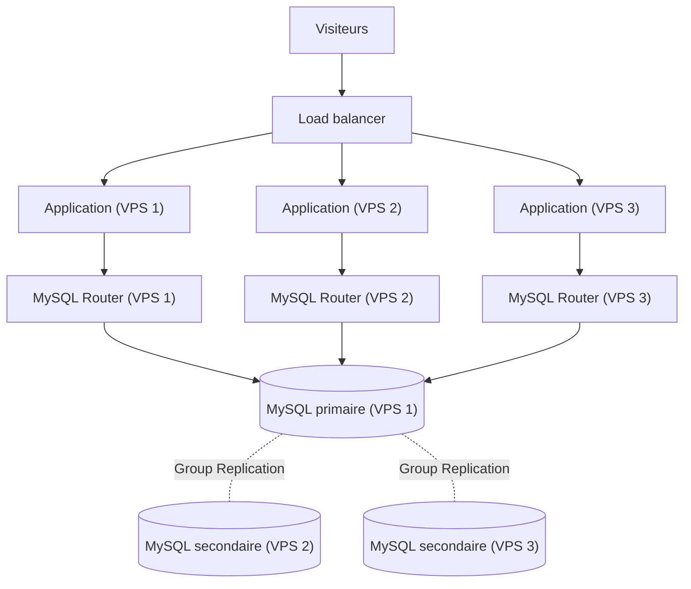

# Cluster à trois nœuds (InnoDB Cluster)

Trois VPS se trouvent derrière un load balancer. Chacun héberge l'application, MySQL Router et MySQL sous Docker. [InnoDB Cluster](https://dev.mysql.com/doc/mysql-shell/8.4/en/mysql-innodb-cluster.html) réplique la base entre les trois nœuds avec Group Replication, et seul le primaire accepte les écritures.



- Le load balancer écarte toute instance qui échoue à son contrôle de santé.
- Chaque application passe par le routeur de son VPS, qui dirige les écritures vers le primaire.
- Si le primaire tombe, les secondaires en élisent un nouveau en quelques secondes, et les routeurs le suivent automatiquement.
- Le cluster tolère la panne d'un nœud sur trois. Au-delà, il perd la majorité et la base devient inaccessible.

## Simulation locale

| Service                              | Rôle          | Accès                                   |
| ------------------------------------ | ------------- | --------------------------------------- |
| `lb`                                 | Load balancer | [localhost:8080](http://localhost:8080) |
| `vps1-app`, `vps1-router`, `vps1-db` | VPS 1         | [localhost:8081](http://localhost:8081) |
| `vps2-app`, `vps2-router`, `vps2-db` | VPS 2         | [localhost:8082](http://localhost:8082) |
| `vps3-app`, `vps3-router`, `vps3-db` | VPS 3         | [localhost:8083](http://localhost:8083) |

Les commandes s'exécutent depuis le dossier de l'exemple, et les identifiants ne servent qu'à la simulation locale.

```sh
docker compose up --wait vps1-db vps2-db vps3-db
./scripts/setup.sh
docker compose up --build --wait
docker compose run --rm --no-deps vps1-app php tests/smoke.php http://lb
```

Le script crée le cluster avec vps1 comme primaire, puis copie sa base vers vps2 et vps3 par clonage. Les routeurs ne démarrent qu'une fois le cluster en place.

L'état du cluster indique son primaire et le nombre de pannes qu'il peut encore supporter.

```sh
docker compose exec vps1-db mysqlsh --no-defaults --uri root:local-root-password@localhost \
    --js -e 'print(dba.getCluster().status())'
```

## Panne du primaire MySQL

Arrêter la base de vps1. Pendant les quelques secondes nécessaires à l'élection d'un nouveau primaire, les écritures échouent. Le routeur de vps1 dirige ensuite les nouvelles écritures vers ce nouveau primaire.

```sh
docker compose stop vps1-db
sleep 10
docker compose run --rm --no-deps vps1-app php tests/smoke.php http://lb
docker compose start --wait vps1-db
```

Au redémarrage, la base rejoint le cluster comme secondaire.

## Panne d'un VPS

Arrêter tous les services de vps1. Le load balancer écarte ce VPS et, si sa base était primaire, le cluster en élit un nouveau.

```sh
docker compose stop vps1-app vps1-router vps1-db
sleep 10
docker compose run --rm --no-deps vps2-app php tests/smoke.php http://lb
docker compose start --wait vps1-db vps1-router vps1-app
```

Au retour du VPS, son routeur redémarre en boucle jusqu'à ce que sa base ait rejoint le cluster.

## Perte de la majorité

Simuler la panne brutale de deux bases. Sans majorité, le cluster bloque les écritures. Au bout de quelques dizaines de secondes, MySQL Router coupe aussi les lectures et le site répond `503`.

```sh
docker compose kill vps2-db vps3-db
```

Relancer les bases ne suffit pas. Il faut d'abord rétablir la majorité sur vps1, pendant que les deux autres bases sont arrêtées, puis les relancer et les réintégrer.

```sh
docker compose exec vps1-db mysqlsh --no-defaults --uri root:local-root-password@localhost \
    --js -e "dba.getCluster().forceQuorumUsingPartitionOf('vps1-db:3306')"
docker compose start --wait vps2-db vps3-db
docker compose exec vps1-db mysqlsh --no-defaults --uri root:local-root-password@localhost \
    --js -e "const c = dba.getCluster(); c.rejoinInstance('vps2-db:3306'); c.rejoinInstance('vps3-db:3306')"
```

## Arrêt

```sh
docker compose down
```

Les volumes MySQL sont conservés, mais le cluster ne se reforme pas seul après l'arrêt simultané des trois bases, comme ici ou lors d'un redémarrage de Docker. Il faut alors lancer les bases, reformer le cluster, puis démarrer le reste.

```sh
docker compose up --wait vps1-db vps2-db vps3-db
docker compose exec vps1-db mysqlsh --no-defaults --uri root:local-root-password@localhost \
    --js -e 'dba.rebootClusterFromCompleteOutage()'
docker compose up --wait
```

Pour repartir de zéro, utiliser `docker compose down -v`, puis reprendre la procédure de démarrage.
